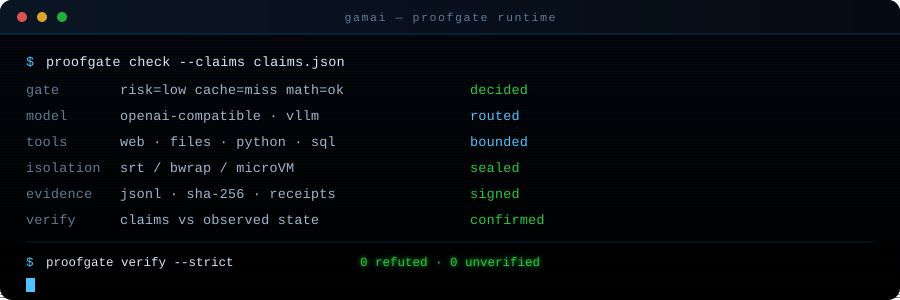
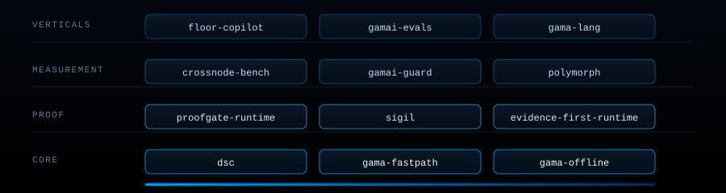
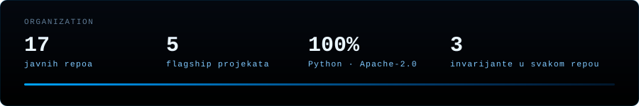

<!-- gamai-matrix-header-v1 -->

  
  
  
  
  

## Šta je gamAI

gamAI je **trust layer za AI agente**: sloj koji odlučuje _prije_ izvršenja, izoluje _tokom_ izvršenja i dokazuje _poslije_ izvršenja. Agent koji tvrdi da je posao završen — a nije — je najskuplji bug u produkciji. Naš odgovor nije bolji prompt, nego **provjerljiv dokaz**.

Tri invarijante koje svaki repo u organizaciji poštuje:

| Invarijanta          | Značenje                                                             | Gdje se provodi                         |
| -------------------- | -------------------------------------------------------------------- | --------------------------------------- |
| **Decidable before** | svaka akcija ima odluku prije izvršenja (allow / deny / needs-proof) | `proofgate-runtime`, `dsc`              |
| **Isolated while**   | izvršenje u ograđenom prostoru (srt / bwrap / microVM)               | `gama-sandbox`, `sigil`                 |
| **Provable after**   | tvrdnja se poredi sa stvarnim stanjem, rezultat je potpisan          | `evidence-first-agent-runtime`, `sigil` |

## Kako radi

Claim ulazi u gate. Gate odlučuje. Model se izvršava u izolaciji sa ograničenim alatima. Sve što se desilo ide u evidence log (JSONL + SHA-256). Verifikacija poredi tvrdnju sa opservacijom — i ako se ne slažu, tvrdnja je **refuted**, ne "vjerovatno tačna".

## Ekosistem

## Flagship

| Repo                                                                                         | Šta rješava                                              | Dokaz                                          |
| -------------------------------------------------------------------------------------------- | -------------------------------------------------------- | ---------------------------------------------- |
| [**proofgate-runtime**](https://github.com/gamai-io/proofgate-runtime)                       | gate koji odlučuje prije akcije; fail-closed po defaultu | deterministički, bez LLM-a u kritičnoj putanji |
| [**evidence-first-agent-runtime**](https://github.com/gamai-io/evidence-first-agent-runtime) | runtime gdje je dokaz primarni artefakt, ne log          | evidence chain + verifikacija tvrdnji          |
| [**sigil**](https://github.com/gamai-io/sigil-public)                                        | potpisivanje i verifikacija receipt-a                    | SHA-256 chain, offline verifikacija            |
| [**crossnode-bench**](https://github.com/gamai-io/crossnode-bench-public)                    | mjerenje pouzdanosti agenata kroz više čvorova           | javni dataset + reproducibilni runovi          |
| [**gamai-guard**](https://github.com/gamai-io/gamai-guard-public)                            | politike i granice za toolske pozive                     | policy engine, audit trail                     |

## Principi

- **Mjereno, ne marketinški.** Svaka tvrdnja u README-u ima run ili test iza sebe.
- **Fail-closed.** Ako dokaz nema, odgovor je `unverified` — nikad `ok`.
- **Bez magije.** Determinitički sloj je odvojen od modela; model je zamjenjiv dio.
- **Lokalno prvo.** Radi bez clouda; cloud je opcija, ne uslov.
- **Otvoreno.** Javni repoi, javni benchmark, javni rezultati — uključujući one koji nam ne idu u prilog.

## Stack

  

## Kontakt

- Web: **gamai.io**
- Organizacija: [github.com/gamai-io](https://github.com/gamai-io)
- Sigurnost: vidi [SECURITY.md](https://github.com/gamai-io/.github/blob/main/SECURITY.md)

<!-- gamai-matrix-footer-v1 -->

<code>evidence before assertion</code> · <code>decidable before · isolated while · provable after</code>

© gamAI · trust layer for AI agents

