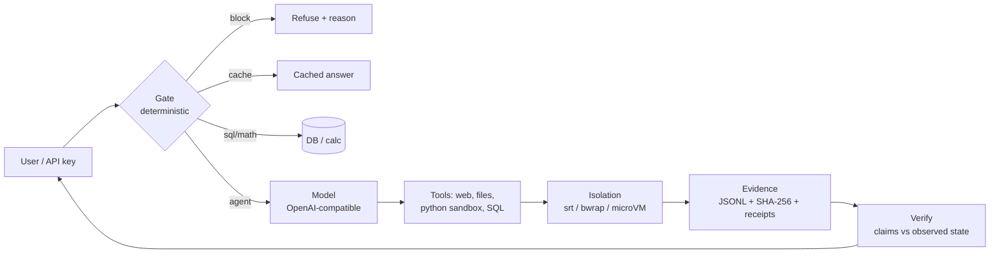

# gamAI — trust layer for AI agents

Agents that claim success for work that failed are a liability. gamAI makes each step **decidable before the model runs**, **isolated while it runs**, and **provable after it runs**.

🌐 [gamai.io](https://gamai.io) · 📊 [Benchmarks](https://gamai.io/benchmarks) · 📦 [Open source](https://gamai.io/opensource) · ✉️ info@gamai.io

## Architecture

- **Gate** — risk, cache, math and routing decided without spending tokens.
- **Motor** — any OpenAI-compatible endpoint (hosted or local vLLM/Ollama).
- **Tools** — MCP servers, function calling, sandboxed execution.
- **Evidence** — append-only logs, hashes, receipts; “done” requires proof.

## Core vs. applications

| Layer | What it is | Repos |
| --- | --- | --- |
| **Core (reusable)** | gate, isolation, evidence, node trust, determinism, benchmarks | `evidence-gate-runtime`, `gama-sandbox`, `gnp-trust`, `dsc`, `dag`, `sigil` |
| **Measurement** | honesty under load, GUI grounding, tool calling | `crossnode-bench` |
| **Toolkits** | Python trust primitives, prompt-injection guard | `gamai-trust`, `gamai-guard` |
| **Applications** | chat, experts, OCR, estimates, research (hosted at gamai.io) | private / hosted |

Core stays domain-agnostic; verticals consume it as a library or a service.

## Principles

1. **Evidence before assertion** — every claim is checkable.
2. **Least privilege** — destructive actions gated; no secrets in code or logs.
3. **Determinism where possible** — same input, same bytes, on every node.
4. **Measured, not marketed** — benchmarks state method and reproduction.

## Start here

- [Full benchmark suite](https://gamai.io/benchmarks) — why, how, reproduce.
- [Open source overview](https://gamai.io/opensource) — `pip install` / clone per repo.
- [Security policy](SECURITY.md) — report vulnerabilities to security@gamai.io.

License: Apache-2.0 for core repositories; some companion repos are MIT — see `LICENSE` in each repository.
