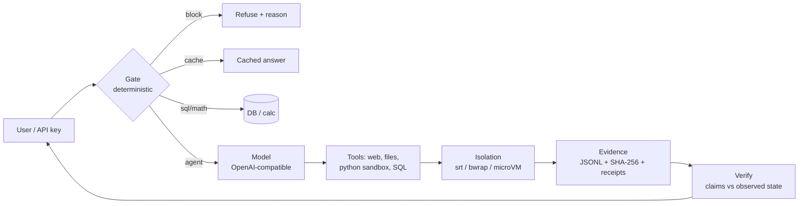

# gamAI — trust layer for AI agents

Agents that claim success for work that failed are a liability. gamAI makes each step **decidable before the model runs**, **isolated while it runs**, and **provable after it runs**.

🌐 [gamai.io](https://gamai.io) · 📊 [Benchmarks](https://gamai.io/benchmarks) · 📦 [Open source](https://gamai.io/opensource) · ✉️ info@gamai.io

## Architecture

- **Gate** — risk, cache, math and routing decided without spending tokens.
- **Motor** — any OpenAI-compatible endpoint (hosted or local vLLM/Ollama).
- **Tools** — MCP servers, function calling, sandboxed execution.
- **Evidence** — append-only logs, hashes, receipts; “done” requires proof.

## Status (2026-11-05)

### Product
- **ProofGate Runtime v0.2** — [`proofgate-runtime`](https://github.com/gamai-io/proofgate-runtime) · [PyPI](https://pypi.org/project/proofgate-runtime/) — claim verification (`confirmed/refuted/unverified`), signed receipts (HMAC-SHA256; unsigned rejected by default), lite injection pre-filter, CLI and MCP server. Stdlib only. *Not independently audited; PyPI 0.2.0: `pip install proofgate-runtime`. External audit RFP is open.*
- **SIGIL/1** — [`sigil`](https://github.com/gamai-io/sigil) — proof-carrying execution: grants, receipts, anchor, MCP/A2A middleware; 6-container production reference.
- **Measurement** — [`crossnode-bench`](https://github.com/gamai-io/crossnode-bench) — 25,600 controlled claim-vs-truth trials; 93.75% pass; 6.25% planted lies flagged; 0 false-success on read/action/cross. *Controlled detection test, not a field rate.* · [dataset v0.1.0](https://github.com/gamai-io/crossnode-bench/tree/main/dataset) · [preprint](https://github.com/gamai-io/crossnode-bench/blob/main/paper/preprint.pdf)
- **Guard** — [`gamai-guard`](https://github.com/gamai-io/gamai-guard) — multilingual prompt-injection cascade (29/30 blind attacks, 0/10 FP; 6,900 corpus 79.6%/0.1%).
- **Isolation** — [`gama-sandbox`](https://github.com/gamai-io/gama-sandbox) + [`gnp-trust`](https://github.com/gamai-io/gnp-trust) — srt/bwrap/microVM isolation, node token gate, leases with fencing.
- **Deterministic core** — [`dsc`](https://github.com/gamai-io/dsc), [`gama-fastpath`](https://github.com/gamai-io/gama-fastpath), [`gama-offline`](https://github.com/gamai-io/gama-offline) — normalize, cache, risk gate, money math.
- **Case study** — [`floor-copilot`](https://github.com/renatoschust-dot/floor-copilot) (moved to the personal account) — invoice intake with 17% VAT gate; synthetic 100-case gate benchmark: 40/40 valid, 30/30 arithmetic errors caught, 0 false verifications; plus 15 GAMA-style invoices with real Tesseract OCR: 8/8 valid, 4/4 arithmetic errors caught, 0 false verifications. OCR name mismatch remains a documented gap.

### Experimental
`gama-lang`, `agentmujo-training`, `gamai-evals`, `polymorph` live on this org.
Side projects moved to [`renatoschust-dot`](https://github.com/renatoschust-dot): `gama-hifz`, `dag`, `risk-calib`, `gamai-skills`, `polyscope`, `gama-lumi-bench`.

### Legacy / not recommended
`gama-shard`, `gama-retrieval`, `gama-agent` — kept for reference; prefer the product paths above.

Core stays domain-agnostic; verticals consume it as a library or a service.

## Principles

1. **Evidence before assertion** — every claim is checkable.
2. **Least privilege** — destructive actions gated; no secrets in code or logs.
3. **Determinism where possible** — same input, same bytes, on every node.
4. **Measured, not marketed** — benchmarks state method and reproduction.

## Start here

- [External audit RFP (draft)](https://github.com/gamai-io/proofgate-runtime/blob/main/docs/external-audit-rfp.md) — scope, deliverables, rules of engagement.
- [Security audit (internal, 2026-11-05)](https://github.com/gamai-io/.github/blob/main/security/2026-11-05-audit.md) — internal review, **not** an independent external audit.

- [Full benchmark suite](https://gamai.io/benchmarks) — why, how, reproduce.
- [LUMI-G benchmark (2026-11-06)](https://github.com/gamai-io/gamai-evals/blob/main/docs/LUMI_BENCHMARK_2026-11-06.md) — grounding and tool-calling numbers with protocol and limitations.
- [ProofGate Runtime v0.2](https://github.com/gamai-io/proofgate-runtime) — start here: claims, receipts, MCP.
- [Open source overview](https://gamai.io/opensource) — clone per repo.
- [Security policy](SECURITY.md) — report vulnerabilities to security@gamai.io.

License: Apache-2.0 for core repositories; some companion repos are MIT — see `LICENSE` in each repository. `proofgate-runtime` v0.2 is not independently audited.
